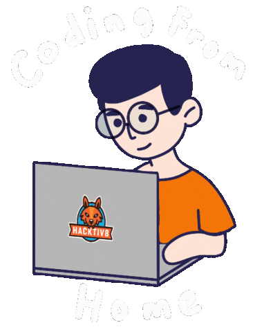

<p align="center">
  
</p>

<p align="center">
  <a href="https://github.com/duyquang392"></a>
  
  
</p>


##  About Me

```python
class QuangDuy:
    location = "Hanoi, Vietnam"
    role = "AI Engineer & Software Developer"
    focus = [
        "Computer Vision",
        "Video Analytics",
        "OCR / Document AI",
        "LLM Applications",
    ]
    langs = ["Python", "C++", "Go", "TypeScript", "Kotlin"]

    def say_hi(self):
        print("Hi, nice to meet you!")
```



- Working on **CCTV & video analytics**: object detection, tracking, behavior recognition.
- Building **traffic AI systems**: license plate recognition, speed and road monitoring.
- Experience in **OCR & Document AI**: Vietnamese OCR, layout analysis, table extraction.
- Exploring **remote sensing & GIS**: land-change detection, segmentation, map platforms.
- Developing **LLM applications**: chatbots and AI agents.
- Deploying models to production with **MLOps & Edge AI**.
- Open to collaborate on **AI / Computer Vision projects**.

##  Tech Stack

**Languages**

       

**AI / Computer Vision**

        

**Backend, Web & Apps**

     

**Databases**

   

**DevOps, MLOps & Edge**

    

## Featured Projects

| Project | Description | Tech |
|---|---|---|
| [**Financial-statement-Information-Extractor**](https://github.com/duyquang392/Financial-statement-Information-Extractor) | End-to-end pipeline extracting information from financial statements: direction classification, layout analysis, text detection/recognition, table recovery | Python · OCR · Deep Learning |
| [**Vietnamese_OCR**](https://github.com/duyquang392/Vietnamese_OCR) | Optical character recognition for Vietnamese text | Python · OCR |
| [**LayoutAnalysis_YOLOv7**](https://github.com/duyquang392/LayoutAnalysis_YOLOv7) | Document layout analysis (header / table / text) with YOLOv7 | Python · YOLOv7 |

More on my [repositories](https://github.com/duyquang392?tab=repositories) page.

## GitHub Stats

<div align="center">


</div>

## Contribution Snake


##  Reach Out To Me

<p align="left">
  <a href="https://linkedin.com/in/duy-quang-097411243"></a>
  <a href="https://www.facebook.com/profile.php?id=100027411617399"></a>
  <a href="https://github.com/duyquang392"></a>
</p>

## Random Dev Quote

<div align="center">
  
</div>


